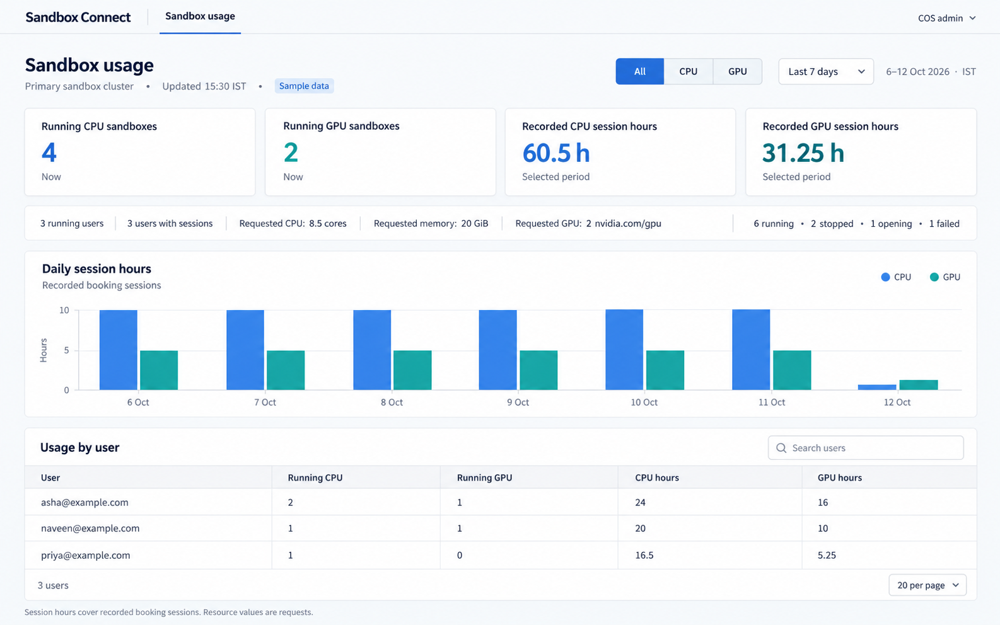
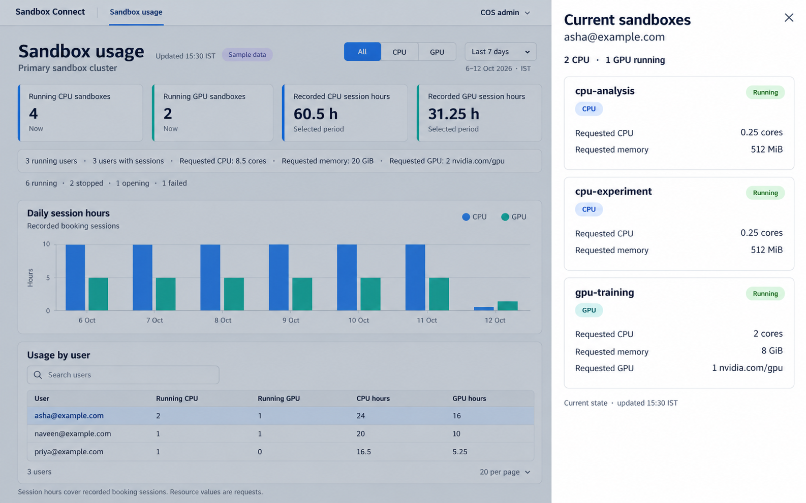

# CPU/GPU dashboard mockups

Generated visual concepts for the COS admin CPU/GPU dashboard.
Built-in image_gen was used; all displayed data is synthetic. These images do not represent implemented API integration.

## Overview

Four cards, one daily CPU/GPU session-hours chart, and the users table.

## User sandbox details

Selecting a user opens a read-only panel of their current sandboxes and resource requests.

[Exact generation prompts](generation-prompts.json)
